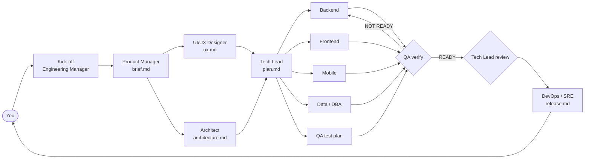

<div align="center">

# 🧑‍💻 Claude Dev Team

**A complete software development team for [Claude Code](https://docs.claude.com/en/docs/claude-code) — 10 specialized agents, one command.**

Product Manager · Tech Lead · Architect · UI/UX · Backend · Frontend · Mobile · Data/DBA · QA · DevOps/SRE

`/dev-team Add password reset by email`

[Install](#-install) · [How it works](#-how-it-works) · [The team](#-the-team) · [Example](#-real-example) · [Português](#-em-português)

</div>

---

Claude is great at writing code. Real software also needs someone to ask **why**, someone to design **how it fits**, someone to **plan** the work, specialists to **build** it, someone to **break** it and someone to **ship** it safely.

`dev-team` turns Claude Code into that team. One skill acts as the **Engineering Manager**: it picks the right team size, spawns each role as its own agent with only the context it needs, runs independent work **in parallel**, enforces **quality gates** between phases and hands you tested, reviewed code plus the docs a real team would leave behind.

## ✨ Highlights

- **10 real roles**, each with its own focused instructions and deliverables.
- **Right-sized**: *Lite* for a bug fix (4 agent runs), *Standard* for a feature, *Full* for a new product — it never spins up a Mobile dev for a repo without an app.
- **Parallel by design**: UX + Architect design together; developers and QA's test plan run at the same time with **disjoint file ownership**, so agents don't step on each other.
- **Quality gates**: QA must say `READY`, the Tech Lead must approve the review — with up to 3 automatic fix loops.
- **Paper trail**: every decision lands in `.dev-team/` (brief, UX, architecture/ADRs, plan, test plan, QA report, review, release + rollback plan).
- **Safe**: never deploys, pushes or runs destructive migrations without your explicit OK. Respects your repo's `CLAUDE.md` and conventions.
- **Cheap to keep**: ~1.2k tokens always-on; the rest loads only when the team works.

## 📦 Install

In Claude Code:

```text
/plugin marketplace add Kesh-2k/claude-dev-team
/plugin install dev-team@claude-dev-team
```

Restart Claude Code, then:

```text
/dev-team <what you want built>
```

…or just ask: *"use the dev team to add CSV export to the reports page"*.

<details>
<summary>Manual install (without the plugin system)</summary>

Copy `plugins/dev-team/agents/*.md` to `~/.claude/agents/` (or `.claude/agents/` in a project) and `plugins/dev-team/skills/dev-team/` to `~/.claude/skills/dev-team/`. The skill automatically falls back to the bare agent names.
</details>

## 🔄 How it works



| Mode | When | Team |
|---|---|---|
| **Lite** | bug fix, small endpoint, copy change | Tech Lead → 1 dev → QA → review |
| **Standard** | a normal feature | PM → Architect (+UX) → plan → devs ∥ QA plan → QA → review → release |
| **Full** | new product, new data model or infra | every role, plan approval by you |

## 👥 The team

| Role | Agent | Responsible for | Delivers |
|---|---|---|---|
| Product Manager / PO | `product-manager` | **What** and **why now**: problem, users, prioritized stories, acceptance criteria, metrics | `brief.md` |
| Tech Lead / Eng. Manager | `tech-lead` | Bridges business & tech: task breakdown with file ownership, standards, Definition of Done, final code review | `plan.md`, `review.md` |
| Software Architect | `software-architect` | Macro structure, APIs, integrations, security, scalability, tech choices as ADRs | `architecture.md` |
| UI/UX Designer | `ux-designer` | User flows, wireframes for every state, copy, accessibility, design-system consistency | `ux.md` |
| Backend Developer | `backend-developer` | Business rules, APIs, auth, async jobs, databases, external integrations + tests | code |
| Frontend Developer | `frontend-developer` | Web UI, state, API consumption, loading/empty/error states, a11y, performance + tests | code |
| Mobile Developer | `mobile-developer` | iOS/Android lifecycle, offline, push, permissions, store readiness + tests | code |
| Data Engineer / DBA | `data-engineer` | Modeling, safe migrations, indexes & query plans, pipelines, governance/PII | migrations |
| QA Engineer | `qa-engineer` | Test plan up front, automated tests, real exercising, defects with repro steps, verdict | `test-plan.md`, `qa-report.md` |
| DevOps / SRE | `devops-sre` | CI/CD, containers, observability, secrets, backups, release & rollback plan | `release.md` |

## 🧪 Real example

`/dev-team Add a slugify(text) function ... with tests. Use Lite mode.` on a tiny Node project:

- **Agents called:** `tech-lead` (plan) → `backend-developer` → `qa-engineer` → `tech-lead` (review)
- **Result:** `src/slugify.js` + 19 passing tests (accents, `ß→ss`, symbols, edge cases), QA verdict READY, review approved, nothing committed until you say so.
- **Cost:** about US$ 1 with Claude Opus.

See the artifacts the team produced in [`examples/slugify-lite`](examples/slugify-lite).

## 💡 Tips

- Be specific about the outcome, not the implementation — the PM and Architect will work out the rest.
- Say *"Full mode, show me the plan first"* for big work; *"Lite"* for quick fixes.
- Re-run `/dev-team` later: existing `.dev-team/` artifacts are reused, so the team picks up where it stopped.
- Add `.dev-team/` to git if you want the design docs reviewed in PRs.

## 🤝 Contributing

Ideas for new roles (Security Engineer, Tech Writer, Data Scientist…), better prompts or real-world examples are very welcome — open an issue or a PR.

## 📄 License

[MIT](LICENSE) © Kesh-2k

---

## 🇧🇷 Em português

**Uma equipe completa de desenvolvimento para o Claude Code**: Product Manager, Tech Lead, Arquiteto, UI/UX, Backend, Frontend, Mobile, Dados/DBA, QA e DevOps/SRE — 10 agentes coordenados por uma skill.

```text
/plugin marketplace add Kesh-2k/claude-dev-team
/plugin install dev-team@claude-dev-team
/dev-team <o que você quer construir>
```

A skill escolhe o tamanho da equipe (Lite, Standard ou Full), roda em paralelo o que é independente, exige o "PRONTO" do QA e a aprovação do Tech Lead, e deixa tudo documentado em `.dev-team/`. Nunca publica, faz push ou mexe em produção sem a sua autorização. Os agentes respondem no idioma do pedido.
