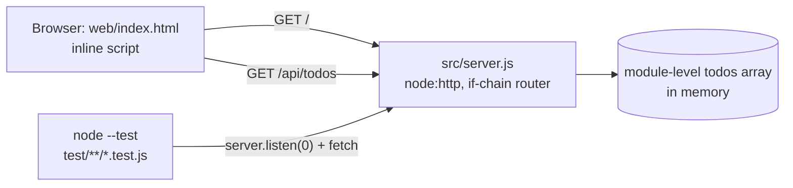
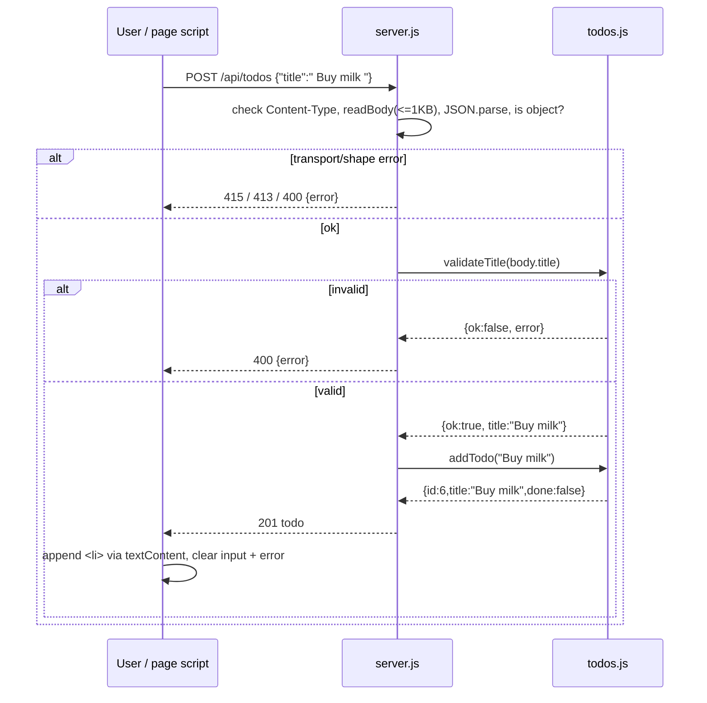

# Architecture: Add a new todo (POST /api/todos + form)

Scope: small feature. The app stays zero-dependency: Node 22 ESM, raw `node:http`, in-memory store, one static page with an inline script.

## 1. Context (current)



Facts that shape the design:
- `server.js` exports `server` and only listens on :3000 when run directly. Tests can import it and call `listen(0)`.
- The request handler is `async`. If it throws, the result is an unhandled promise rejection, and Node 22 exits the process on that. Bad input on the new POST path must never throw out of the handler.
- Routing compares `req.url` exactly. `/api/todos?x=1` and `/api/todos/` return 404. **We keep this behaviour.** We do not add URL parsing in this change. It is recorded as known behaviour in section 5.
- The page renders titles with `innerHTML`, which allows stored XSS once users can set titles. This is fixed here (M3).

## 2. Proposed design

### 2.1 Components

| File | Change |
|---|---|
| `src/todos.js` (new) | A pure domain module with no I/O. It holds the store and the validation. Exports: `validateTitle(input)`, `listTodos()`, `addTodo(title)`, `resetTodos(seed?)`. |
| `src/server.js` | Adds a `POST /api/todos` branch, a `readBody(req, limit)` helper, a `sendJson(res, status, obj)` helper, and a try/catch around the handler that returns 500. GET reads the list from `listTodos()`. |
| `web/index.html` | Adds the form and an inline error element. Renders every title with `textContent`, both on first load and on add. Removes `innerHTML`. |
| `test/todos.test.js`, `test/api.test.js` (new) | A unit test file and an HTTP test file. See section 7. |

Interface sketch for `src/todos.js`:
```js
export const MAX_TITLE = 120;
export function validateTitle(input)  // -> { ok: true, title } | { ok: false, error }
export function listTodos()           // -> Todo[]  (the array; callers must not mutate it)
export function addTodo(title)        // expects an already-validated title -> Todo
export function resetTodos(seed = [{ id: 1, title: 'First task', done: false }]) // for tests
```
`validateTitle` takes the raw `body.title` value of any type. It does the type check, trims, and checks the length. `addTodo` does no validation. The server calls `validateTitle` first, then `addTodo`.

### 2.2 API contract: `POST /api/todos`

**Request**
- Header: `Content-Type: application/json`. A suffix such as `; charset=utf-8` is allowed. The server checks that the media type, before any `;`, is `application/json`, ignoring case.
- Body: a JSON object `{ "title": string }`. All other fields (`id`, `done`, and anything else) are **ignored**. The server builds the new todo field by field and never spreads or merges the body.

**Success: `201 Created`**
```
Content-Type: application/json; charset=utf-8
{"id":6,"title":"Buy milk","done":false}
```
`title` is the trimmed value. No `Location` header is set because there is no GET-by-id route.

**Errors.** Every error body is `{"error":"<message>"}` with `Content-Type: application/json; charset=utf-8`. The checks run in this order and the first failure wins:

| # | Condition | Status | `error` message (exact) |
|---|---|---|---|
| 1 | Media type is not `application/json`, or the header is missing | 415 | `Content-Type must be application/json` |
| 2 | Body is larger than 1024 bytes | 413 | `Request body too large` |
| 3 | Body is empty, or `JSON.parse` throws | 400 | `Invalid JSON` |
| 4 | Parsed value is not a plain object (`null`, an array, a string, a number) | 400 | `Body must be a JSON object` |
| 5 | `title` is missing (`undefined`) | 400 | `title is required` |
| 6 | `title` is not a string (a number, `null`, an object, and so on) | 400 | `title must be a string` |
| 7 | `title.trim()` is empty | 400 | `title must not be empty` |
| 8 | `title.trim().length > 120` | 400 | `title must be at most 120 characters` |
| - | An unexpected exception | 500 | `Internal server error` |

Checks 5 to 8 belong to `validateTitle`. Checks 1 to 4 belong to the server. After any error, the store is unchanged.

Length is measured with JS `.length` (UTF-16 code units). This is the same unit the HTML `maxlength` attribute counts, so the client and the server agree. Trimming uses `String.prototype.trim()`, which also strips Unicode whitespace.

`GET /api/todos` keeps its behaviour. It reads from `listTodos()` and also gets the `; charset=utf-8` suffix through `sendJson`.

### 2.3 Body reading
`readBody(req, 1024)`:
- If the `Content-Length` header is present and larger than the limit, reject straight away with 413 without reading the body.
- Otherwise read with `for await (const chunk of req)`, collect the Buffers, and keep a running byte count. When the count goes over the limit, stop collecting and reject with 413. This also catches chunked bodies that have no `Content-Length`.
- Decode once at the end with `Buffer.concat(chunks).toString('utf8')`. Do not concatenate strings chunk by chunk, because that can split multibyte characters.
- When sending a 413, set `Connection: close` so the client does not keep streaming into a socket we reuse. Call `res.end()` before tearing anything down. If `req.destroy()` runs first, the client gets a socket reset instead of the 413.
- `JSON.parse` sits inside its own try/catch and maps to 400 `Invalid JSON`. Errors on the request stream go to the top-level catch, which returns 500. The server must never crash.

Why 1 KB is enough: the largest valid title is 120 code units. Even if every unit is written as a `\uXXXX` escape (6 bytes), that is 720 bytes, plus 12 bytes for `{"title":""}`. Bodies padded with a lot of whitespace before trimming can get a 413. That is acceptable.

### 2.4 Id generation
`id = max(existing ids) + 1`, or `1` when the list is empty, as the brief says. This is computed in `addTodo`. The cost is O(n) per insert, which is fine for an in-memory demo list. Node runs the handler on one thread and `addTodo` is synchronous, so there is no race between concurrent POSTs.

### 2.5 Front end (`web/index.html`)
- Markup: `<form id="add">` containing a `<label>` and an `<input name="title" maxlength="120" autocomplete="off">`, plus a `<button>Add</button>`, then `<p id="error" role="alert">`, then the existing `<ul id="list">`.
- Do **not** put `required` on the input. Native browser validation would block an empty submit and hide the server's message. The inline server error is what the acceptance criteria test.
- On `submit` (this also covers pressing Enter): call `preventDefault`, disable the button, and POST JSON. On 201: append an `<li>` whose `textContent` is the title, clear the input, and clear the error. On an error response: show `body.error` through `textContent`, keep the input text, and leave the list unchanged. On a network failure: show a generic message. In `finally`: re-enable the button.
- Use one `renderItem(todo)` function that runs `createElement('li')` and sets `textContent`. Use it for both the initial load and new items. The file must contain no `innerHTML`, `outerHTML`, or `insertAdjacentHTML`.

### 2.6 Main flow



## 3. Decisions (ADRs)

### ADR-1: Validation and store live in a new pure module, `src/todos.js`
- **Context:** The acceptance criteria need unit-testable validation and tests that start from a known state, such as "existing ids 1 and 5". Today the store is a private `const` inside `server.js`.
- **Options:** (a) Keep everything in `server.js` and export `validateTitle` from there. (b) Create `src/todos.js` holding the validation and the store.
- **Decision:** (b). The module does no I/O, so `validateTitle` can be tested without HTTP. `resetTodos(seed)` gives tests a supported way to set state without reaching into module internals. `server.js` keeps only HTTP concerns.
- **Consequences:** One more file. The store is still a module-level singleton, so tests must reset it (section 7). If persistence is added later, it can replace the `listTodos` and `addTodo` implementations without touching the HTTP layer.

### ADR-2: Oversized body returns 413, not 400
- **Context:** The brief says "invalid input returns 400". It does not cover body size.
- **Options:** Return 400 `{error}` for everything, or return 413 for size.
- **Decision:** 413 `Request body too large`, with the same `{error}` JSON shape. The body is not *invalid*. It was never read. 413 is the standard code, it tells clients that retrying the same request will not help, and it keeps the 400 cases strictly about content. 415 for a wrong `Content-Type` follows the same reasoning.
- **Consequences:** The contract has three 4xx codes instead of one. The page script shows `body.error` for any non-2xx response, so the user experience is the same.

### ADR-3: Zero dependencies, with hand-written body and JSON handling
- **Context:** The project convention is zero dependencies and no build step.
- **Decision:** No router or body-parser library. Use about 20 lines of helpers (`readBody`, `sendJson`) in `server.js`. Keep the exact-match `if`-chain router.
- **Consequences:** We own the edge cases ourselves: the limit, decoding, parse errors, and async errors. These are listed in section 2.3 and covered by tests. If routes grow past roughly 5, a small route table should be considered, but not now.

## 4. Cross-cutting concerns
- **AuthN/AuthZ:** None, by design (non-goal). Anyone who can reach the port can add todos. Do not expose it publicly.
- **CSRF:** Requiring `application/json` (415 otherwise) means a cross-site HTML form or a simple `fetch` cannot post. A non-simple content type triggers a CORS preflight, and the server never answers that with CORS headers. Do not add `Access-Control-Allow-Origin`.
- **Input validation:** Whitelist one field, `title`. Check its type before calling `.trim()`, which avoids a `TypeError` on numbers. The new object is built from fields explicitly: `{ id, title, done: false }`.
- **Prototype pollution:** `JSON.parse` does not pollute, and we never merge the body into anything, so there is no risk.
- **Secrets and PII:** None. Titles are user content, so do not log them.
- **Performance and scalability:** The 1 KB body limit and the O(n) id scan are fine. Memory grows without bound because there is no cap on the number of todos. That is accepted for an in-memory demo and is a known DoS-style limit.
- **Observability:** Keep it minimal. In the top-level catch, `console.error` the stack, then return 500. No request logging is needed.
- **Failure modes:** Every path in the handler ends in exactly one `res.end()`. A try/catch around the whole handler body prevents unhandled rejections. If the headers were already sent when an error happens, only call `res.end()`.

## 5. Tech debt and coupling
- **Exact `req.url` matching:** `/api/todos?x=1` and `/api/todos/` return 404. This is kept on purpose. If it becomes a problem, compare on `new URL(req.url, 'http://x').pathname` in one place.
- **Unknown method on `/api/todos`:** For example `DELETE`, which falls through to the 404. A 405 would be more correct, but it is out of scope.
- **Singleton store:** This is the only shared state. All access goes through the `todos.js` functions. The server must not import or mutate the array directly.
- **`listTodos()` returns the live array:** That is acceptable because `JSON.stringify` only reads it. Do not hand the array to code that mutates it.
- **Inline script with no CSP:** Adding a CSP would need a script hash. It is deferred. `textContent` is the actual XSS control.

## 6. Security checklist
- [ ] **XSS (stored):** All titles are rendered with `textContent` or `createElement`. `web/index.html` contains no `innerHTML`, `outerHTML`, or `insertAdjacentHTML`. A test asserts this.
- [ ] **XSS (error path):** The server error message is also shown with `textContent`.
- [ ] **Body size:** Limited to 1024 bytes. Both `Content-Length` and the streamed byte count are checked. The response is 413 and the server stays up.
- [ ] **Malformed input:** Parse errors and wrong types return 400. Nothing throws out of the handler. A test confirms that GET still works after each error.
- [ ] **Mass assignment:** Client-sent `id` and `done` are ignored. A test covers this.
- [ ] **Content-Type:** Requests must be `application/json` (415 otherwise). This is the CSRF mitigation. Responses carry an explicit `Content-Type` with charset.
- [ ] **CORS:** No CORS headers are added.
- [ ] **Error leakage:** A 500 returns a generic message. Stacks go only to the server console.
- [ ] Optional, cheap: send `X-Content-Type-Options: nosniff` on JSON responses.

## 7. Testing approach
- **Runner:** `node --test`, using only `node:test` and `node:assert/strict`, plus the global `fetch` built into Node 22.
- **`test/todos.test.js` (unit):** Tests `validateTitle` on: `"  Buy milk  "` returning `"Buy milk"`; exactly 120 characters (ok) and 121 (error); `""`; `"   "`; `undefined`; `123`; `null`; `{}`. It asserts the exact error strings from the table above. It also tests `addTodo` id rules: an empty list gives 1, and ids [1, 5] give 6.
- **`test/api.test.js` (HTTP):** In `before`, call `server.listen(0)` and read the port from `server.address().port`. In `after`, call `server.close()`. Cover: 201 with the body shape; GET includes the new todo; `id` and `done` in the body are ignored; each 400 case with its exact message and the list unchanged; empty body; `{"title":` (malformed); `[]`; a wrong content type returns 415; a 2 KB body returns 413. After the error cases, GET still returns 200, which shows the server did not crash.
- **Page check:** Read `web/index.html` as text and assert it does not contain `innerHTML`, and does contain `textContent` and a `maxlength="120"` input.
- **Shared state warning:** `todos` is module-level, so all tests in one file share it. `node --test` runs each test file in its own process, so files do not interfere with each other, but tests inside a file do. Call `resetTodos()` in `beforeEach`. Use `resetTodos([{id:1,...},{id:5,...}])` for the id test. Do not assume an absolute list length unless you reset first.
- **Fetch keep-alive:** Node's `fetch` keeps connections alive, which can delay `server.close()`. Call `server.closeAllConnections()` before `close()` in `after` so the test process exits promptly.
