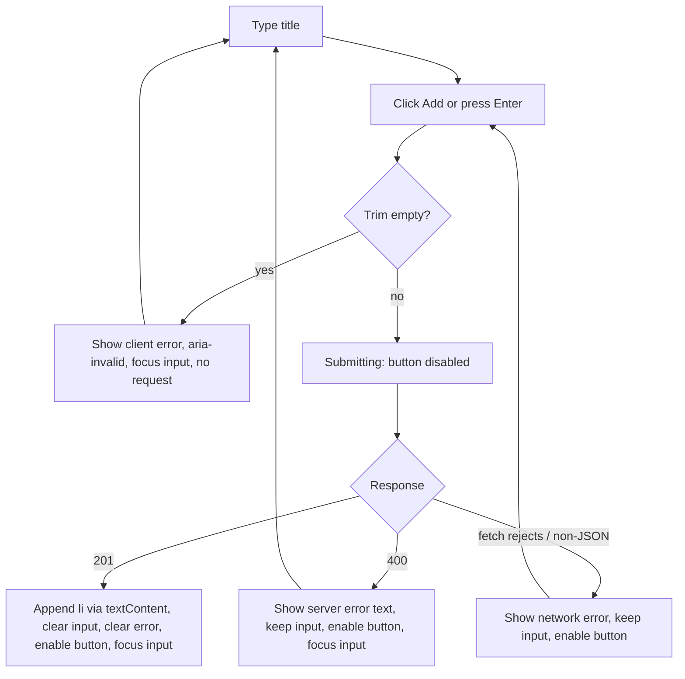

# UX: Add todo form

Scope: one small form on the existing bare page. No framework, no CSS library, no design system exists. Use native elements and browser defaults. At most a few inline styles (see Design-system changes).

## 1. Users and key tasks
- End user: type a task and add it in one action (click or Enter), with no reload, and see clearly when it did not work.
- Keyboard and screen reader user: same task without a mouse, and hear errors.

## 2. Flow


## 3. Screen (single page)
Placement: form directly under the h1, above the list.

```
Todos
-----------------------------
Title [______________________] [Add]
(error text here, empty when none)

 * Existing todo 1
 * Existing todo 2
```

Markup contract for devs (ids are used by tests):
- `form#add-form` (novalidate, so our own message shows instead of the browser bubble)
- `label[for=title]` visible text "New todo"
- `input#title` type=text, name=title, maxlength=120, required, autocomplete=off
- `button#add-btn` type=submit, text "Add"
- `p#error` role=alert (implicit aria-live assertive), always present in the DOM, empty when no error
- `ul#list` unchanged. New items are `li` with `textContent`.

Native `<form>` gives Enter-to-submit for free. Do not add a keydown handler.

## 4. States
| State | Behaviour |
|---|---|
| Idle | Input empty, button "Add" enabled, `#error` empty, input has no aria-invalid. |
| Submitting | Button disabled and its text "Adding..."; input stays editable. Submit handler returns early if already submitting (guards Enter, which can fire while the button is disabled). |
| Success | Append `li` with the title returned by the server (trimmed), clear input, clear `#error`, remove aria-invalid, restore button, focus input. |
| Client validation error | Title empty or whitespace after trim: no request, show "Enter a title.", set aria-invalid=true, focus input. Do not clear the text. Over-length cannot be typed due to maxlength, the server still enforces it. |
| Server error (400) | Show the `error` string from the JSON body verbatim in `#error`, set aria-invalid=true, keep input value, re-enable button, focus input. If the body has no usable `error`, use the fallback copy. |
| Network error | fetch rejects or the response is not parseable: show "Could not reach the server. Check your connection and try again.", keep input, re-enable button. No aria-invalid (the title is not the problem). |
| Empty list | List renders nothing, as today. Optional, not required for this release. |
| Initial load failure | Out of scope for this feature (existing behaviour). |
| No permission | Not applicable, no auth. |

Clearing rule: `#error` text and aria-invalid are cleared at the start of each new submit attempt and on success. Also clear aria-invalid when the user edits the input.

## 5. Copy (exact)
- Label: `New todo`
- Button: `Add`; while submitting: `Adding...`
- Client validation: `Enter a title.`
- Server error: the server's `error` text, unchanged
- Fallback when a non-OK response has no `error`: `Could not add the todo. Try again.`
- Network error: `Could not reach the server. Check your connection and try again.`
- No placeholder (the label is enough, placeholders vanish on typing).

## 6. Accessibility
- Focus order: input, Add button, then page content. After success or an error, focus returns to the input so typing can continue.
- Label is a real `<label for="title">`, visible, not placeholder-only.
- `#error` has `role="alert"` and exists on page load (so announcements work). Set its text via `textContent`. Link it with `aria-describedby="error"` on the input.
- `aria-invalid="true"` on the input only for title problems (client or 400).
- Contrast and size: keep browser defaults (black on white). If styling the error, use a dark red such as `#b00020` on white (about 7:1) and never rely on colour alone, the message is text. Default button and input heights are at least 24 px. Add `padding` inline if you want closer to 44 px, optional.
- Motion: none. No animations or transitions.
- Disabled button is announced as dimmed by screen readers. The `Adding...` text change makes the busy state clear.

## 7. Design-system changes
None. There is no design system. Allowed inline styles (optional, at most these):
- `style="color:#b00020"` on `#error`
- `style="margin:.5em 0"` on the form
Do not add a `<style>` block or any CSS file.

## 8. Usability risks and quick validation
- Error is far from the field if the page grows: it sits directly under the input, keep it there. Check with a screen reader (NVDA or VoiceOver) that it announces once.
- Silent double submit via fast Enter presses: validate by pressing Enter twice rapidly against a slowed server, expect one new item.
- Success is only visible as a new row at the bottom of the list, which may be offscreen on a long list. Acceptable for now. If testers miss it, scroll the new item into view.
- Server `error` wording is shown verbatim, so it must be user-readable (the brief makes it a non-empty string; devs should keep messages plain, for example "Title must be 120 characters or fewer.").
- Quick check: five-second test, ask someone to add "Buy milk", then submit blank, and see whether they understand what happened.

## Open UX questions
None blocking. Optional: character counter (brief item C1) is not designed here, since maxlength already stops over-length input.
